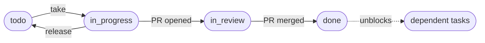

<div align="center">

# 📋 Task Tracker

**A lightweight task board for dev teams that lives where your team already works: GitHub, Discord and your AI assistant.**


[](LICENSE)
[](https://hits.sh/github.com/MinAnnie/task-tracker-public/)

[Features](#-features) · [How it works](#-how-it-works) · [Quick start](#-quick-start) · [Deploy](#-deploy) · [Docs](#-documentation)

</div>

---

## ✨ Features

| | |
| --- | --- |
| 🔐 **GitHub sign-in** | No new passwords. Admins come from an env var; members are added from the app, and removing one ends their access immediately. |
| 🧱 **Real dependencies** | A task can't be started until everything it depends on is `done`. Cycles are rejected. |
| ✋ **Take & release** | One click to claim a task. Two people taking it at once never both win. |
| 🔗 **PRs link themselves** | Put the task key (`RF-04`) in the branch or PR title. Opening the PR moves the task to `in_review`, merging it moves it to `done`. |
| 💬 **Discord notifications** | Each project posts to its own channel: new tasks, takes, assignments, PRs and unblocked tasks. |
| 🪪 **Discord account linking** | Connect your Discord account from the account menu (OAuth, `identify` scope only). Linked users get a real `@mention` when a task is assigned to them, and can use the bot. |
| ⌨️ **Slash commands** | `/tasks`, `/mine`, `/task`, `/take` and `/release` right from the project's channel, with key autocomplete and private replies. |
| 📥 **Bulk import** | Load a whole backlog, with dependencies, from one JSON file. Validated first, written in a single transaction. |
| 🔎 **Board filters** | Search by text and filter by availability (ready or blocked), priority, stage and assignee; the filters live in the URL, so you can share them. |
| 🤖 **Copy for AI** | Every task can be copied as a ready-made Markdown brief for your coding assistant. |
| 🧠 **MCP server** | Project-scoped, read-only API tokens plus an MCP server, so an agent can ask "what should I work on next?". |

## 🔄 How it works



- **Projects** hold tasks with keys like `RF-14`, unique per project and never reused.
- Each task has a **priority** (`urgent`, `high`, `medium`, `low`), an optional **stage** and a **status** (`todo`, `in_progress`, `in_review`, `done`, `blocked`).
- **Admins** see every project. **Members** see only the projects they belong to.

## 🚀 Quick start

Requirements: Node 24, pnpm (via Corepack) and Docker.

```sh
corepack enable
pnpm install
cp .env.example .env            # fill in the GitHub OAuth app and POSTGRES_PASSWORD

# Postgres only, published on loopback
POSTGRES_PASSWORD=change-me docker compose -f docker-compose.yml -f docker-compose.dev.yml up -d --wait db

pnpm dev        # API on :3000 (runs migrations on startup), web on :5173
```

Open http://localhost:5173. Vite proxies `/api`, `/auth` and `/health` to the server without rewriting the `Origin` header, so set `APP_BASE_URL=http://localhost:5173` in `.env` and use `http://localhost:5173/auth/github/callback` as the callback URL of your development GitHub OAuth app.

<details>
<summary><b>More scripts</b></summary>

```sh
pnpm test              # unit tests (Vitest)
pnpm test:integration  # tests against Postgres (needs the db container above)
pnpm typecheck
pnpm build
pnpm db:generate       # create a migration after editing apps/server/src/db/schema.ts
```

Full stack in Docker, with ports published locally:

```sh
docker compose -f docker-compose.yml -f docker-compose.dev.yml up --build
curl http://127.0.0.1:3000/health
```

</details>

## ⚙️ Environment variables

| Variable | Description |
| --- | --- |
| `DATABASE_URL` | Postgres connection string (built automatically in `docker-compose.yml`). |
| `PORT` | HTTP port of the server (default `3000`). |
| `GITHUB_WEBHOOK_SECRET` | Secret used to verify GitHub webhook signatures. Required. |
| `GITHUB_CLIENT_ID` / `GITHUB_CLIENT_SECRET` | Credentials of the GitHub OAuth app used for login. Required. |
| `ADMIN_GITHUB_LOGINS` | Comma-separated GitHub logins with the admin role (case-insensitive). Admins manage members from the app. Required; empty fails startup. |
| `APP_BASE_URL` | Public origin of the app, e.g. `https://your-tracker.example.com`. The OAuth callback is `<APP_BASE_URL>/auth/github/callback`; cookies get `Secure` when it is https. Required. |
| `DISCORD_BOT_TOKEN` | Token of the Discord bot that posts project notifications. Optional; when unset, notifications are disabled (logged once at startup). Never logged. |
| `DISCORD_APPLICATION_ID` / `DISCORD_CLIENT_SECRET` | OAuth2 client id and secret of the Discord application used to link accounts. Optional, but set both or neither (only one fails startup); when unset, linking is disabled. Add `<APP_BASE_URL>/auth/discord/callback` as a redirect in the Discord developer portal. The secret is never logged. |
| `DISCORD_PUBLIC_KEY` | Public key (64 hex characters) of the Discord application, used to verify slash command requests. Optional; when unset, `POST /discord/interactions` answers `404`. A malformed value fails startup. |
| `DISCORD_GUILD_ID` | Only read by the `discord:register` script: registers the commands in this server instead of globally. |
| `WEB_DIST_DIR` | Directory of the built web app to serve at `/` (set in the Docker image). |
| `POSTGRES_USER` / `POSTGRES_PASSWORD` / `POSTGRES_DB` | Database credentials used by Compose. `POSTGRES_PASSWORD` is required. |

## 🐳 Deploy

The repository ships a `Dockerfile` and a `docker-compose.yml` (app + Postgres). On [Dokploy](https://dokploy.com):

1. Create a **Compose** app pointing at this repository (compose file: `docker-compose.yml`).
2. Set the environment variables in the Dokploy UI: `POSTGRES_PASSWORD` (required by Compose) plus the app variables above. Compose does not enforce the app variables; the app refuses to start when any is missing.
3. In **Domains**, add your domain targeting service `app`, port `3000`. Dokploy's Traefik handles routing and TLS; the compose file publishes no host ports.
4. Deploy. Migrations run automatically on app startup; `GET /health` reports DB connectivity.

Then point a GitHub webhook at `<APP_BASE_URL>/webhooks/github` ([details](docs/api.md#github-webhook)).

### Connecting Discord (optional)

All three Discord features use the same application from the [Discord developer portal](https://discord.com/developers/applications):

1. **Bot → Token** into `DISCORD_BOT_TOKEN`, and invite the bot with the `bot` + `applications.commands` scopes. Set each project's channel in Admin → the project.
2. **OAuth2**: copy the client id and secret into `DISCORD_APPLICATION_ID` / `DISCORD_CLIENT_SECRET`, and add `<APP_BASE_URL>/auth/discord/callback` as a redirect. Users then connect their account from the account menu → **Connect Discord**.
3. **General Information → Public Key** into `DISCORD_PUBLIC_KEY`, deploy, set the **Interactions Endpoint URL** to `<APP_BASE_URL>/discord/interactions` and register the commands.

Step by step, with every message and command: [docs/discord.md](docs/discord.md).

## 🗂️ Project layout

```text
apps/
├── server/   Hono API (Node 24, TypeScript), Drizzle ORM + PostgreSQL. Pure domain logic in src/domain/
├── web/      React + Vite SPA (React Router, TanStack Query, CSS Modules), served by the server in production
└── mcp/      Read-only MCP server (stdio) over the API-token endpoints
docs/         API, Discord and import reference
```

The server follows a ports-and-adapters design: use cases in `src/application/` depend on interfaces, with Postgres, GitHub and Discord adapters in `src/infrastructure/` and in-memory fakes for tests. The web app splits screens into containers (data) and presentational components (props) under `src/features/`.

## 📚 Documentation

- [HTTP API](docs/api.md): roles, admin, projects and tasks endpoints, the GitHub webhook and API tokens
- [Discord](docs/discord.md): notifications, account linking and slash commands
- [Bulk import](docs/import.md): the JSON format and the `import-tasks` CLI
- [MCP server](apps/mcp/README.md): build, configuration and Claude Code registration

## 📄 License

[MIT](LICENSE) © 2026 Angie Matiz
